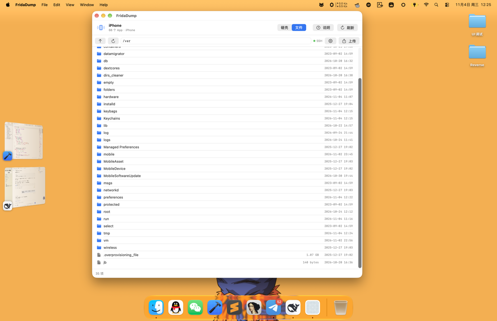
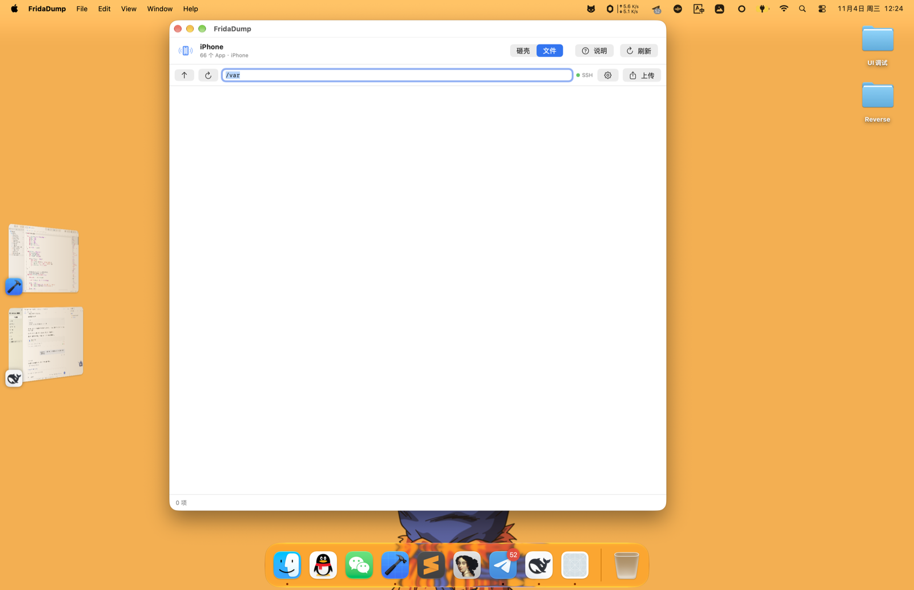
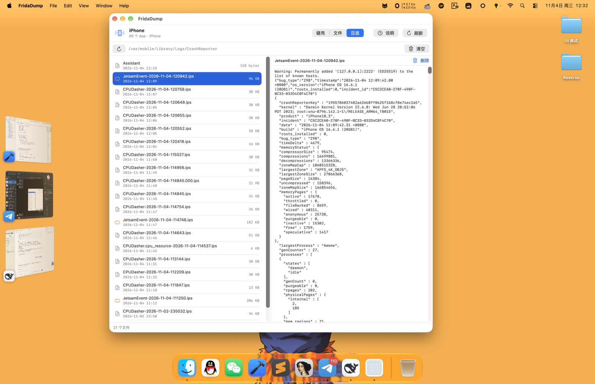
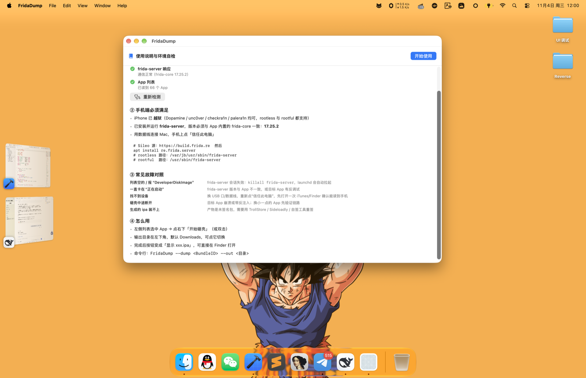

# FridaDump

一个原生 macOS 应用：把越狱 iPhone 上的 App 砸壳导出成 IPA，顺带把文件管理、崩溃日志查看都做进去了。

界面用 SwiftUI，砸壳走 [frida-core](https://frida.re) 直连（不依赖 Python、不依赖 SSH），文件与日志走设备自带的 SSH。



---

## 功能

### 1. 砸壳（解密 IPA）

- 列出设备上全部 App（名称 / BundleID / 运行状态）
- 选中即砸，自动完成：结束运行实例 → spawn → 注入 → 解密所有 Mach-O → 回传资源 → 打包 IPA
- 解密对象包括主二进制和 `Frameworks/` 下全部动态库，写入前把 `LC_ENCRYPTION_INFO` 的 `cryptid` 清零
- 输出目录可自定义，中间产物打包后自动清理

### 2. 文件管理



- 像 Finder 一样浏览设备文件系统（默认 `/var`），路径栏可直接输入跳转
- 双击文件夹进入，双击文件下载到 `~/Downloads/FridaDump/`
- 上传：从 Mac 选择文件或整个目录推到设备当前路径
- 右键：打开、下载、复制路径、删除

### 3. 崩溃日志



- 直接读取设备 `/var/mobile/Library/Logs/CrashReporter`
- 列表按时间倒序，`JetsamEvent` 橙色标记、`panic` 红色标记
- 点开看全文，支持选中复制
- 单条删除 / 一键清空整个目录

### 4. 环境自检



- 首次启动显示教程页，之后可从右上角「说明」随时打开
- 三项实时检测：USB 设备、frida-server 响应、App 列表
- 失败直接给出修复建议，不用再去翻文档

---

## 环境要求

**设备端**

| 项 | 要求 |
|---|---|
| 越狱 | Dopamine / unc0ver / checkra1n / palera1n，rootless 与 rootful 均可 |
| frida-server | **必须 17.25.2**（与 App 内置的 frida-core 版本一致） |
| openssh | 仅「文件」「日志」功能需要 |
| 连接 | 数据线连 Mac，手机上点「信任此电脑」 |

```sh
# Sileo 添加源 https://build.frida.re 后
apt install re.frida.server
apt install openssh

# 路径
# rootless: /var/jb/usr/sbin/frida-server
# rootful : /usr/sbin/frida-server
```

**Mac 端**

- macOS 14+
- Xcode 16+（用于自己编译）
- 不需要装 Python，不需要配 iproxy —— 砸壳走 usbmuxd 直连，文件管理所需的端口转发由 App 自己拉起

---

## 编译

frida-core 的 devkit 体积太大不放进仓库，编译前先下载对应版本：

```sh
mkdir -p vendor && cd vendor

# Apple Silicon
curl -L -o devkit.tar.xz https://github.com/frida/frida/releases/download/17.25.2/frida-core-devkit-17.25.2-macos-arm64.tar.xz

# Intel 用这个
# curl -L -o devkit.tar.xz https://github.com/frida/frida/releases/download/17.25.2/frida-core-devkit-17.25.2-macos-x86_64.tar.xz

tar xf devkit.tar.xz
cd ..

xcodebuild -project FridaDump.xcodeproj -scheme FridaDump -configuration Release build
```

产物在 `build/Build/Products/Release/FridaDump.app`。首次运行前 ad-hoc 签名：

```sh
codesign --force --deep --sign - FridaDump.app
```

---

## 使用

1. 打开 App，首次会显示环境自检，三项全绿即可用
2. **砸壳**：左侧选中目标 App → 点右下角「开始砸壳」（或双击）
3. **文件**：切到「文件」页，首次自动配置 SSH（生成密钥 → 用密码推送公钥 → 免密），之后直接浏览
4. **日志**：切到「日志」页查看设备崩溃记录

### 命令行模式

```sh
FridaDump.app/Contents/MacOS/FridaDump --dump <BundleID> --out <输出目录>
```

例：

```sh
FridaDump.app/Contents/MacOS/FridaDump --dump com.ss.iphone.ugc.Aweme --out ~/Desktop/out
```

---

## 常见问题

| 现象 | 原因与处理 |
|---|---|
| 列表是空的 / 报 `DeveloperDiskImage` | 设备端 frida-server 会话失效：`killall frida-server`，launchd 会自动拉起 |
| 一直卡在「正在启动」 | frida-server 版本与 App 不一致，或目标 App 有反调试 |
| 找不到设备 | 换 USB 口/数据线，重新点「信任此电脑」 |
| 砸壳中途断开 | 目标进程被系统杀掉，换小一点的 App 先验证链路 |
| 生成的 ipa 装不上 | 产物未签名，需要 TrollStore / Sideloadly / 自签工具重签 |
| 文件页连不上 | 设备没装 openssh，或密码不是默认的 `alpine`（右上角齿轮可改） |

### 已知限制

**超大 App 会失败。** 抖音这类（本体 2 GB、`AwemeCore` 单框架 427 MB）在回传阶段会被 iOS 的 Jetsam 以 `vm-pageshortage` 杀掉 —— 因为解密后的数据要穿过目标 App 自己的进程内存再转发到 Mac。数百 MB 以内的 App 正常。后续计划改成设备端落盘 + SFTP 拉取，彻底绕开进程内存。

---

## 技术实现

```
FridaDump/
├── FridaBridge.c/.h      # libfrida-core C 封装：spawn → attach → 注入 → resume
├── DumpScript.swift      # 注入到目标进程的脚本：Mach-O 解密 + 目录遍历 + 分块回传
├── DumpReceiver.swift    # 接收数据流、落盘、打包 IPA
├── FridaService.swift    # 设备/应用列表、砸壳状态机
├── SSHService.swift      # SSH/SFTP：列目录、上传下载、读日志、免密配置
├── FileBrowserView.swift # 文件管理界面
├── LogsView.swift        # 崩溃日志界面
├── GuideView.swift       # 教程与环境自检
├── HeadlessRunner.swift  # 命令行入口
└── ContentView.swift     # 主界面
```

几个绕不开的细节：

- **注入必须早于 resume**。先 `spawn` 得到挂起进程，注入脚本，再 `resume`；反过来脚本注入时进程已经跑起来，会直接 `connection is closed`。
- **运行态进程不能直接 attach**（iOS 16 上会挂死），所以砸壳前先 `kill` 已有实例再 spawn。
- **buffer 用 `malloc` 不能用 `Memory.alloc`**。后者返回的内存会被 frida 的 GC 回收，`read()` 往里写就段错误，且地址固定、表现为必现。
- **大文件传输要节流**。256 KB 一块、每 8 块让出 3 ms，否则发送队列积压直接把目标进程撑爆。
- **解密用的文件权限要显式 `chmod`**。`open(..., O_CREAT|O_RDWR, 0)` 的 mode 传 0 会生成 `--w-------`，写完自己读不回来。

---

## 致谢

- 解密流程参考 [frida-ios-dump](https://github.com/AloneMonkey/frida-ios-dump)（AloneMonkey），并适配了 frida 16/17 的 API 变更
- [frida](https://frida.re) — 动态插桩框架

## License

仅供学习与安全研究使用，请勿用于任何商业用途或侵犯他人权益的场景。
